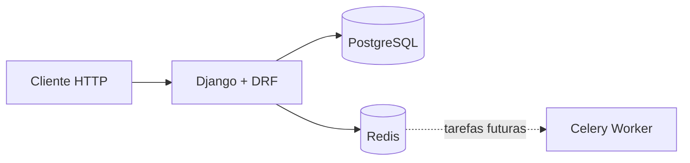

# Inventário de TI

Sistema para controlar ativos de tecnologia, responsáveis, empréstimos, movimentações e manutenções.

## Objetivo

Demonstrar desenvolvimento backend com Django, regras de negócio, autenticação, auditoria, tarefas assíncronas, testes e execução com Docker.

## Recursos disponíveis

- Cadastro e autenticação com JWT.
- Perfis de usuário, técnico e administrador.
- Edição do próprio perfil.
- Gestão de papéis e ativação de contas restrita a administradores.
- Health check e documentação OpenAPI/Swagger.

## Stack planejada

- Python e Django
- Django REST Framework
- PostgreSQL
- Celery e Redis
- Docker Compose
- Pytest e Ruff
- GitHub Actions

## Arquitetura inicial



Nesta primeira etapa, o Compose executa somente os três componentes necessários: aplicação, PostgreSQL e Redis. O worker Celery será incluído quando os alertas assíncronos forem implementados.

## Executar com Docker

```bash
cp .env.example .env
docker compose up --build
```

Serviços disponíveis:

- API: `http://localhost:18000/api/v1/health/`
- Swagger: `http://localhost:18000/api/docs/`
- Administração Django: `http://localhost:18000/admin/`

## Autenticação

Principais endpoints:

| Método | Endpoint | Acesso |
| --- | --- | --- |
| `POST` | `/api/v1/auth/register/` | Público |
| `POST` | `/api/v1/auth/token/` | Público |
| `POST` | `/api/v1/auth/token/refresh/` | Público |
| `GET/PATCH` | `/api/v1/auth/me/` | Autenticado |
| `GET` | `/api/v1/auth/users/` | Administrador |
| `PATCH` | `/api/v1/auth/users/{id}/access/` | Administrador |

Criar uma conta:

```bash
curl -X POST http://localhost:18000/api/v1/auth/register/ \
  -H "Content-Type: application/json" \
  -d '{
    "username": "romario",
    "email": "romario@example.com",
    "first_name": "Romário",
    "last_name": "Silva",
    "password": "SenhaSegura@2026",
    "password_confirmation": "SenhaSegura@2026"
  }'
```

Obter o token:

```bash
curl -X POST http://localhost:18000/api/v1/auth/token/ \
  -H "Content-Type: application/json" \
  -d '{"username":"romario","password":"SenhaSegura@2026"}'
```

Use o token de acesso nas rotas protegidas:

```text
Authorization: Bearer SEU_ACCESS_TOKEN
```

O cadastro público sempre cria o perfil `USER`. Apenas um administrador pode promover outra conta para `TECHNICIAN` ou `ADMIN`. Para criar o primeiro administrador local:

```bash
docker compose exec web python manage.py createsuperuser
```

Para encerrar:

```bash
docker compose down
```

## Desenvolvimento local

```bash
python -m venv .venv
source .venv/bin/activate
pip install -e ".[dev]"
python manage.py migrate
python manage.py runserver
```

Validações:

```bash
ruff format --check .
ruff check .
pytest
python manage.py check
```

## Etapas

1. ✅ Fundação Django, banco, containers, testes e CI.
2. ✅ Autenticação JWT e perfis de acesso.
3. Cadastro de ativos, categorias, setores e status.
4. Empréstimos, responsáveis e movimentações.
5. Manutenções, garantias, custos e anexos.
6. QR Code e auditoria.
7. Dashboard e relatórios.
8. Alertas assíncronos.
9. Segurança, documentação e deploy.

## Fluxo Git

- `main`: versão estável.
- `develop`: desenvolvimento e validação antes da PR.
