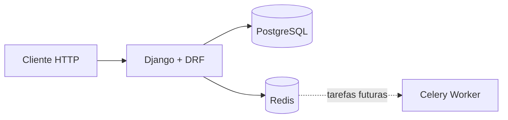

# Inventário de TI

Sistema para controlar ativos de tecnologia, responsáveis, empréstimos, movimentações e manutenções.

## Objetivo

Demonstrar desenvolvimento backend com Django, regras de negócio, autenticação, auditoria, tarefas assíncronas, testes e execução com Docker.

## Recursos disponíveis

- Cadastro e autenticação com JWT.
- Perfis de usuário, técnico e administrador.
- Edição do próprio perfil.
- Gestão de papéis e ativação de contas restrita a administradores.
- CRUD de ativos, categorias, setores e status.
- Pesquisa, filtros, ordenação e paginação do inventário.
- Proteção contra exclusão de cadastros vinculados a ativos.
- Gestão de responsáveis, empréstimos, devoluções e transferências.
- Histórico imutável de movimentações com usuário executor.
- Manutenções transacionais com custos e restauração automática do status do ativo.
- Gestão de garantias, custos e documentos com download autenticado.
- Identificação dos ativos por QR Code e UUID público.
- Trilha de auditoria imutável para alterações e ações operacionais.
- Health check e documentação OpenAPI/Swagger.

## Stack planejada

- Python e Django
- Django REST Framework
- PostgreSQL
- Celery e Redis
- Docker Compose
- Pytest e Ruff
- GitHub Actions

## Arquitetura inicial



Nesta primeira etapa, o Compose executa somente os três componentes necessários: aplicação, PostgreSQL e Redis. O worker Celery será incluído quando os alertas assíncronos forem implementados.

## Executar com Docker

```bash
cp .env.example .env
docker compose up --build
```

Serviços disponíveis:

- API: `http://localhost:18000/api/v1/health/`
- Swagger: `http://localhost:18000/api/docs/`
- Administração Django: `http://localhost:18000/admin/`

## Autenticação

Principais endpoints:

| Método | Endpoint | Acesso |
| --- | --- | --- |
| `POST` | `/api/v1/auth/register/` | Público |
| `POST` | `/api/v1/auth/token/` | Público |
| `POST` | `/api/v1/auth/token/refresh/` | Público |
| `GET/PATCH` | `/api/v1/auth/me/` | Autenticado |
| `GET` | `/api/v1/auth/users/` | Administrador |
| `PATCH` | `/api/v1/auth/users/{id}/access/` | Administrador |

Criar uma conta:

```bash
curl -X POST http://localhost:18000/api/v1/auth/register/ \
  -H "Content-Type: application/json" \
  -d '{
    "username": "romario",
    "email": "romario@example.com",
    "first_name": "Romário",
    "last_name": "Silva",
    "password": "SenhaSegura@2026",
    "password_confirmation": "SenhaSegura@2026"
  }'
```

Obter o token:

```bash
curl -X POST http://localhost:18000/api/v1/auth/token/ \
  -H "Content-Type: application/json" \
  -d '{"username":"romario","password":"SenhaSegura@2026"}'
```

Use o token de acesso nas rotas protegidas:

```text
Authorization: Bearer SEU_ACCESS_TOKEN
```

O cadastro público sempre cria o perfil `USER`. Apenas um administrador pode promover outra conta para `TECHNICIAN` ou `ADMIN`. Para criar o primeiro administrador local:

```bash
docker compose exec web python manage.py createsuperuser
```

## Inventário

| Recurso | Endpoint | Usuário | Técnico | Administrador |
| --- | --- | --- | --- | --- |
| Categorias | `/api/v1/inventory/categories/` | Consultar | Consultar | CRUD |
| Setores | `/api/v1/inventory/sectors/` | Consultar | Consultar | CRUD |
| Status | `/api/v1/inventory/statuses/` | Consultar | Consultar | CRUD |
| Ativos | `/api/v1/inventory/assets/` | Consultar | Criar e atualizar | CRUD |

O sistema cria automaticamente os status `Disponível`, `Em uso`, `Em manutenção` e `Baixado`.

Exemplo de cadastro de ativo por técnico ou administrador:

```bash
curl -X POST http://localhost:18000/api/v1/inventory/assets/ \
  -H "Authorization: Bearer SEU_ACCESS_TOKEN" \
  -H "Content-Type: application/json" \
  -d '{
    "asset_tag": "PAT-001",
    "name": "Notebook Dell Latitude",
    "category": 1,
    "sector": 1,
    "status": 1,
    "serial_number": "SN-001",
    "manufacturer": "Dell",
    "model": "Latitude 5440",
    "acquisition_date": "2026-10-18",
    "purchase_value": "4500.00"
  }'
```

Filtros disponíveis para ativos:

```text
?category=1
?sector=1
?status=1
?search=Dell
?ordering=-updated_at
?acquisition_date__gte=2026-01-01&acquisition_date__lte=2026-12-31
```

## Empréstimos e movimentações

| Método | Endpoint | Descrição |
| --- | --- | --- |
| `GET/POST` | `/api/v1/inventory/responsible-people/` | Consultar e cadastrar responsáveis |
| `GET/POST` | `/api/v1/inventory/loans/` | Consultar e registrar empréstimos |
| `POST` | `/api/v1/inventory/loans/{id}/return/` | Registrar devolução |
| `POST` | `/api/v1/inventory/assets/{id}/transfer/` | Transferir ou atribuir um ativo |
| `GET` | `/api/v1/inventory/movements/` | Consultar o histórico imutável |

Exemplo de empréstimo:

```bash
curl -X POST http://localhost:18000/api/v1/inventory/loans/ \
  -H "Authorization: Bearer SEU_ACCESS_TOKEN" \
  -H "Content-Type: application/json" \
  -d '{
    "asset": 1,
    "borrower": 1,
    "expected_return_date": "2026-10-30",
    "notes": "Uso temporário em projeto"
  }'
```

O empréstimo move o ativo para o setor do responsável e altera seu status para `Em uso`. A devolução restaura o setor de origem e o status `Disponível`. Essas operações usam transações e bloqueio de linha no banco para impedir empréstimos simultâneos do mesmo ativo.

## Manutenções, garantias, custos e anexos

| Método | Endpoint | Descrição |
| --- | --- | --- |
| `GET/POST` | `/api/v1/inventory/maintenances/` | Consultar e iniciar manutenções |
| `POST` | `/api/v1/inventory/maintenances/{id}/complete/` | Concluir e registrar o custo |
| `POST` | `/api/v1/inventory/maintenances/{id}/cancel/` | Cancelar uma manutenção |
| `GET/POST` | `/api/v1/inventory/warranties/` | Gerenciar garantias |
| `GET/POST` | `/api/v1/inventory/costs/` | Gerenciar custos dos ativos |
| `GET/POST` | `/api/v1/inventory/attachments/` | Listar e enviar documentos |
| `GET` | `/api/v1/inventory/attachments/{id}/download/` | Baixar um documento autenticado |

Exemplo de início e conclusão de manutenção:

```bash
curl -X POST http://localhost:18000/api/v1/inventory/maintenances/ \
  -H "Authorization: Bearer SEU_ACCESS_TOKEN" \
  -H "Content-Type: application/json" \
  -d '{
    "asset": 1,
    "maintenance_type": "CORRECTIVE",
    "description": "Substituição da fonte",
    "provider": "Assistência Técnica"
  }'

curl -X POST http://localhost:18000/api/v1/inventory/maintenances/1/complete/ \
  -H "Authorization: Bearer SEU_ACCESS_TOKEN" \
  -H "Content-Type: application/json" \
  -d '{"resolution_notes":"Fonte substituída","cost":"480.50"}'
```

Ao iniciar uma manutenção, o ativo muda para `Em manutenção`. Somente uma manutenção pode ficar aberta por ativo. Na conclusão ou no cancelamento, o status volta para `Disponível` ou `Em uso`, conforme a atribuição atual. O custo da conclusão é registrado automaticamente no histórico financeiro.

Anexos aceitam PDF, PNG, JPG, JPEG e WebP com até 10 MB. Os arquivos ficam em volume persistente no Docker e são entregues somente pela rota autenticada de download. Para produção distribuída, substitua o armazenamento local por um serviço de objetos compatível com S3.

## QR Code e auditoria

Cada ativo recebe um UUID público aleatório. O QR Code contém somente a URL de consulta desse identificador; dados patrimoniais e técnicos continuam protegidos pela autenticação JWT.

| Método | Endpoint | Acesso | Descrição |
| --- | --- | --- | --- |
| `GET` | `/api/v1/inventory/assets/{id}/qr-code/` | Autenticado | Gerar a etiqueta QR em PNG |
| `GET` | `/api/v1/inventory/assets/scan/{public_id}/` | Autenticado | Consultar o ativo ao ler o QR |
| `GET` | `/api/v1/inventory/audit-logs/` | Administrador | Consultar a auditoria imutável |

Baixar a etiqueta:

```bash
curl http://localhost:18000/api/v1/inventory/assets/1/qr-code/ \
  -H "Authorization: Bearer SEU_ACCESS_TOKEN" \
  --output ativo-1-qrcode.png
```

A auditoria registra usuário, ação, recurso, campos alterados, IP, agente do cliente, rota, método e identificador da requisição. Criações, atualizações, exclusões, transferências, devoluções, encerramentos de manutenção e leituras de QR são rastreadas. Os registros não podem ser criados, editados ou excluídos pela API.

Filtros de auditoria disponíveis:

```text
?actor=1
?action=UPDATE
?resource_type=inventory.asset
?object_id=15
?created_at__gte=2026-10-01&created_at__lte=2026-10-31
```

Para encerrar:

```bash
docker compose down
```

## Desenvolvimento local

```bash
python -m venv .venv
source .venv/bin/activate
pip install -e ".[dev]"
python manage.py migrate
python manage.py runserver
```

Validações:

```bash
ruff format --check .
ruff check .
pytest
python manage.py check
```

## Etapas

1. ✅ Fundação Django, banco, containers, testes e CI.
2. ✅ Autenticação JWT e perfis de acesso.
3. ✅ Cadastro de ativos, categorias, setores e status.
4. ✅ Empréstimos, responsáveis e movimentações.
5. ✅ Manutenções, garantias, custos e anexos.
6. ✅ QR Code e auditoria.
7. Dashboard e relatórios.
8. Alertas assíncronos.
9. Segurança, documentação e deploy.

## Fluxo Git

- `main`: versão estável.
- `develop`: desenvolvimento e validação antes da PR.
